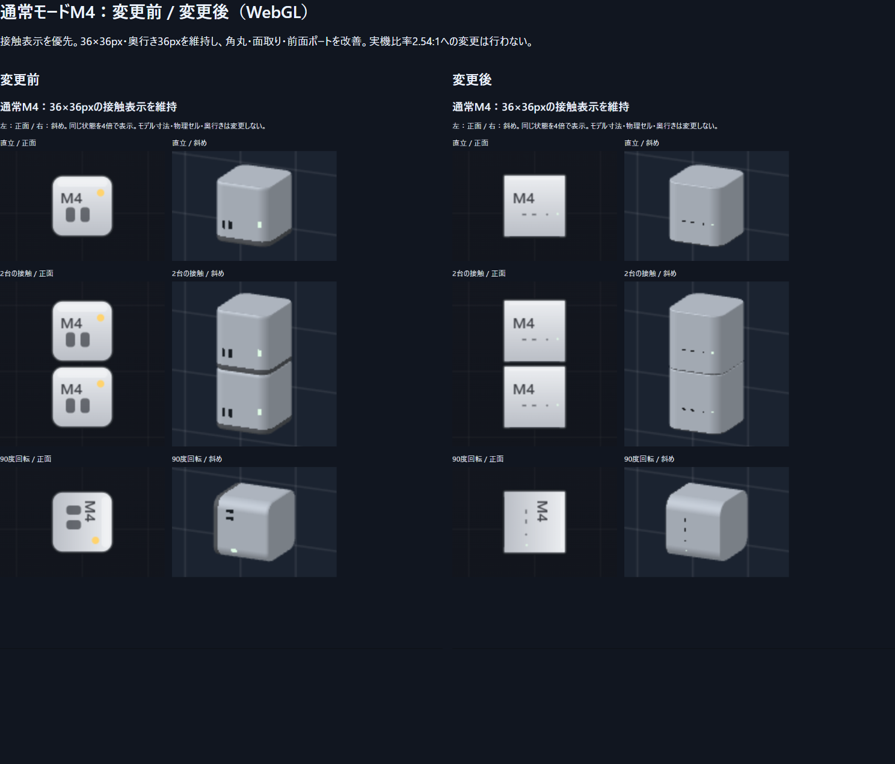
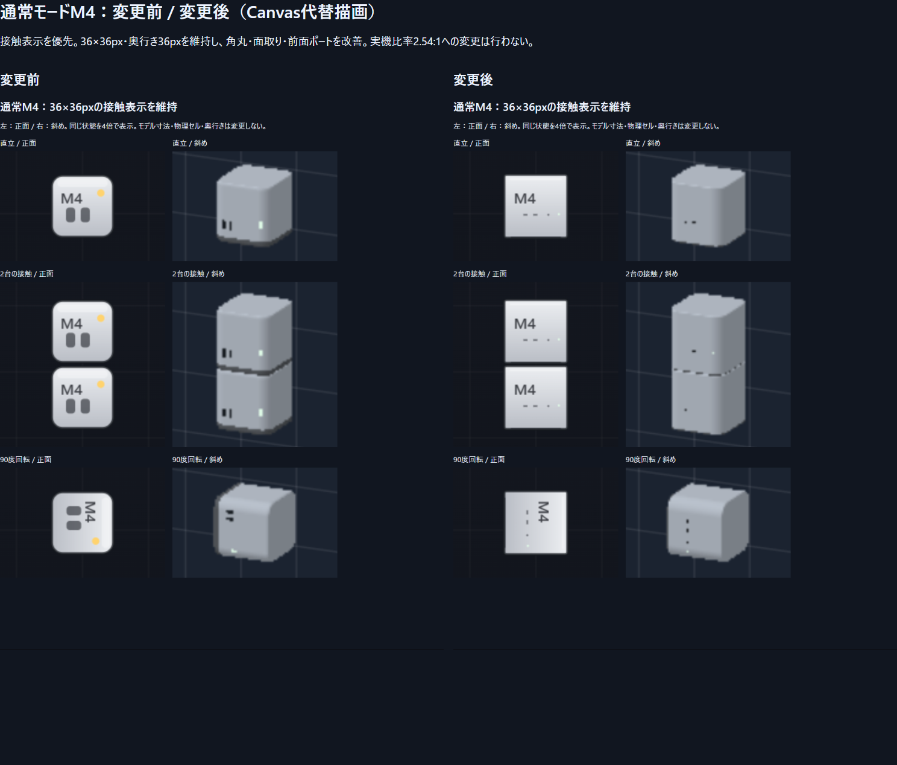

# 通常M4の外観調整：接触表示を優先

基準 `tetris-snap-mode` / `cc8b0d8e45e0f90332bf679338fe06dd24ee8f69`。
新規ブランチ `fix-classic-m4-chassis`。2026-10-29（日本時間）。

## 合意した範囲

調査時点で通常M4の物理セルと正面は36×36px、斜めの描画範囲も36×36×36pxだった。幅36pxで実寸127×127×50mmの比率を保つ場合、表示高さは14.173228pxとなり、36pxの物理セルを維持すると積層時に21.826772pxの見かけの隙間が生じる。

この矛盾を実装前に報告し、ユーザーは**「接触表示を優先：正面36×36pxを維持し、角丸・面取りなどの改善に留める」**を選択した。今回、正面の縦横比を2.54:1へ変更していない。薄型実寸筐体へ変わったと主張せず、通常M4限定の外観改善として扱う。

## 変更内容

本番コードの変更は描画4ファイルに限定する。

- `chassisMesh.ts`: 通常M4だけの水平角丸を調整し、上下の面取りリングを4段から7段へ滑らかにした。通常モードのY倍率2.54を面取りと法線で補正し、縦に膨れた肩を抑えた。面取りのワールド半径は0.72px。角丸半径は外観上の近似であり、Apple CAD値ではない。
- `sprites.ts`: 通常M4だけの36×36pxの正面枠を維持し、外周、細い天面ハイライト、横長USB-C×2、ヘッドフォン端子、細いベースと小さい表示灯を調整した。ポートの位置は3Dと同じ正規化座標へ合わせた。
- `chassisRenderer.ts` / `softwareChassis.ts`: 通常M4でも同じM4ポートパターンを使い、Y倍率で縦長にならないよう補正。ベースと表示灯も通常M4に限って調整した。両バックエンドは同じメッシュを描く。

機種寸法台帳、当たり判定、Matter.js、落下、回転、行消し、スコア、既存の記録・設定、カメラ、回転中心、描画位置、奥行き36pxは変更していない。通常の他5機種、実寸・テトリスの全機種には変更を適用しない。実寸とテトリスは従来どおり`mode:real`の外観を共有する。

## 検証

- `npm test`: **17ファイル・289件合格**。既存283件と専用6件。
- `npm run build`: 成功。
- 本番ビルドのPlaywright: **25件合格、失敗0、対象外11件スキップ**。既存3モードのPC/スマホ・記録・操作を含む全テストを実施した。追加4ケースで通常M4を2台積み、正面・斜めの同一フレーム、1×1セル、接触、WebGL/Canvasを確認した。
- 通常M4のワールドメッシュ範囲は修正前後とも**幅36×高さ36×奥行き36px**。0/90/180/270度の接地、回転中心、頂点法線、上下の接触面の一致を数値検証した。新規の積層ギャップはない。物理ソルバーの小さい許容誤差は既存のまま。
- **対象外11ケース（通常5機種＋実寸6機種）×2バックエンドで、メッシュ・正面画像・斜め画像のSHA256が修正前後で完全一致**した。テトリスが使う実寸M4の描画もこの照合に含む。対象外の見た目を変えていない。
- バックエンド間では全12ケースのメッシュハッシュが一致する。同じ筐体形状であることを検証しており、WebGLとCanvasの材質・アンチエイリアスまで画素一致するとの主張ではない。
- 修正前後の専用比較撮影は、直立、2台の接触、90度回転を同一状態・同一倍率で実施。正面と斜めは同じRenderStateを参照し、JS/console errorは0だった。

生の寸法・ハッシュは [measurements.json](measurements.json)。PC/スマホの実ゲーム画像と元の比較画像は納品outputs/classic-m4へ保存した。

## 比較画像

## 制約と再現

接触表示と既存ゲーム仕様を優先する合意により、通常M4の正面は1:1のゲーム比率のまま。実機の幅:高さ2.54:1の外形を通常モードへ導入する修正は今回の対象外。実寸・テトリスでは従来の実機比率を維持している。既知の新規機能不具合は確認していない。

`npm test`、`npm run build`、`npm run test:e2e`。比較は開発サーバー4173で、`M4_OUTPUT`を指定して`node scripts/capture-classic-m4.mjs before` / `after`。Canvasは`FORCE_SOFTWARE=1`。beforeは基準コミットのソースで撮影する。`node scripts/report-classic-m4.mjs`で比較図と測定JSONを生成する。afterは対象外ハッシュの一致も自動検査する。

本環境では既存ローカルのesbuild-wasm代替とインストール済みChromiumを使用した。依存関係・lockfileへの環境依存変更は含めない。本番E2Eはpreviewの4183ポートへ接続した。
