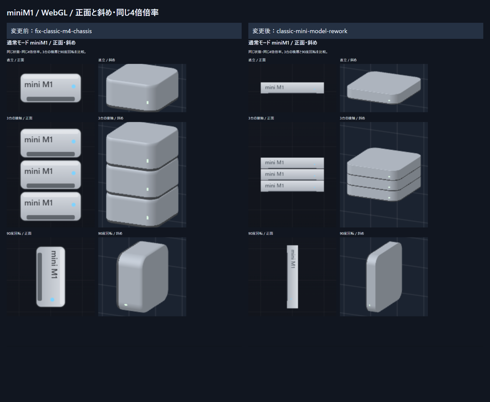
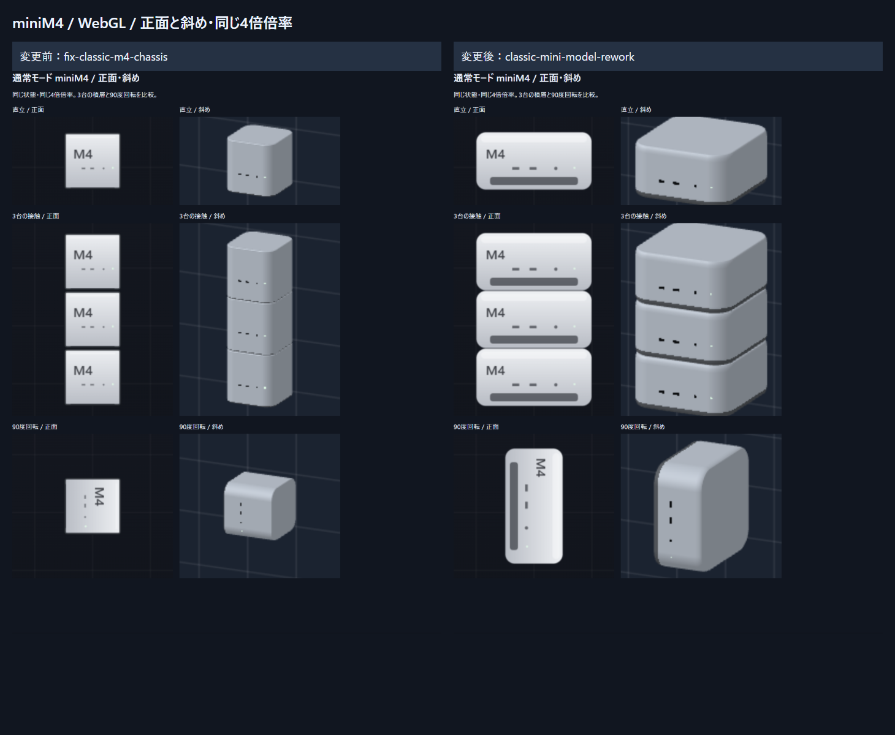

# 通常モード Mac mini 筐体再設計・検証

基準: `fix-classic-m4-chassis` (`30aa736050ac5c31476822d5972d9ab0428af689`)
実装: `classic-mini-model-rework` / 検証日: 2026-10-29

## 実装結果

通常モードのM1/M2は幅・奥行き72pxを保ち、高さを `72×36/197` にした薄型筐体へ変更。M4は基準ブランチのM1/M2の筐体を転用し、72×36×72pxへ変更した。正面スプライト、WebGL、Canvas代替描画、Matterの当たり判定、回転中心、出現位置、NEXT表示が同じ寸法を参照する。

|機種|変更前: 幅×高さ×奥行き px|変更後: 幅×高さ×奥行き px|幅/高さ|
|---|---|---|---|
|M1|72×36×72|72×13.1573604061×72|197/36 = 5.472222|
|M2|72×36×72|72×13.1573604061×72|197/36 = 5.472222|
|M4|36×36×36|72×36×72|2（旧M1/M2モデルの転用を優先）|

M1/M2は197×197×36mmの比率を全軸で維持。角丸の設置面、連続する肩の面取り、アルミの陰影を持つ専用形状にした。奥行きは72pxのまま。M4の3D頂点は旧M1を物理座標へ変換した全頂点と照合し、最大位置差 **0px**。M4固有の前面ポート・LED・識別表示は維持した。正面の装飾用余白は縮め、筐体端が当たり判定の接触面まで届くようにした。

**M4は実寸縮尺のモデルではない。** 実機の幅/高さ127/50=2.54に対し、この通常モードは2.0であり、高さ/幅は実機より27%大きい。今回は指定された「旧M1/M2モデルの転用」を優先する。実寸モードの共通縮尺とM4形状は一切変更していない。

## 接触・回転と既存ルール

- 通常盤面360×648px、36px補助グリッド、左右36px移動、回転入力、危険ライン、スコア計算式、価格・質量・摩擦・出現重み、保存キーを維持。
- miniの四分回転は中心を保ち、端の最後の移動だけ壁までクランプする。薄い辺でも壁を越えない。
- 薄型miniまたはmini断片がある通常盤面のみ、1ステップを4分割してMatterを更新する。薄い当たり判定の通り抜けを防ぐ。該当物体がない通常盤面は従来の1回更新。実寸モードの更新処理は従来どおり。
- 行判定は従来の全幅10マス、各マス90%以上占有。部分幅消去や新ルールは追加していない。miniの小数寸法の残片だけ、既存の幾何クリッピングで実際の消去帯を切り取る。他機種のプランナーは従来と同一。90度から0.2radを超えて傾いた物体の「半分以上重なれば丸ごと消去」という簡易処理も維持。
- 残片の元筐体位置・切断面・質量・価格を保存し、実メッシュと同じ領域の物理ボディを再構築する。

### 3台積層・700ステップ後の実測

メッシュを物理状態からワールド座標へ投影して、底面と床、隣接する上下のキャップを測定。描画専用の接触オフセットは0。下表の負の隙間はMatterの接触解法による微小な食い込みを表す。

|機種|床への誤差 px|上下の隙間 px|脱落数|
|---|---:|---|---:|
|M1|+0.017270|−0.017716 / −0.012946|0|
|M2|+0.017270|−0.017716 / −0.012946|0|
|M4|+0.126317|−0.163450 / −0.087133|0|

最大絶対接触誤差0.164px未満。正の離間はなく、約23pxの表示専用ギャップもない。理想配置の接触面と物理中心の差は0px。0/90/180/270度で物理ボディとメッシュのXY外接範囲を小数8桁で照合。実画面でも各3台積層、同一フレームの正面・斜め表示を確認した。角丸の輪郭には自然な面取りの継ぎ目があり、角の空白まで四角い当たり判定に置き換えてはいない。

## ゲームバランスへの影響

同じ機種を水平に幅いっぱい置いた比較。物体間の微小な食い込みを無視した理論値。

|条件|変更前|変更後|
|---|---|---|
|M1/M2の1層の高さ|36px|13.15736px（36.55%）|
|M1/M2で最初の1行を満たす台数|5台|3層×5台=15台|
|M1/M2の2層|72px|26.31472px、36px行の73.10%で不足|
|M1/M2の3層|108px|39.47208px、消去後は約3.47208pxの残片が5個|
|M4で1行を満たす台数|10台|5台|
|M4の1行整理額|1,150,000円|575,000円|

薄型miniは積層できる台数が増え、水平配置では行消しに必要な台数も増える。M4は横幅が倍になり、壁際の空き幅・回転時の占有幅が変わる。単価・総質量は維持しているため、面積あたりの質量や回転慣性も変化する。薄型miniを含む混在盤面では4分割更新により他のボディの衝突解法にも影響する。これらは見た目と当たり判定を一致させることに伴う通常モード内のバランス変更である。

M2を15台配置するテストでは支出1,050,000円を、消えた面積の整理額と残片価値に正しく按分することを確認。残片の厚み・比例質量を数値検証し、再接地させた。既存ハイスコア・設定は読み書きでき、実寸の記録も保持される。通常モードの旧記録は削除しないため、変更前と難易度が同一の記録にはならない。

## 自動・実画面検証

- `npm test`: **18ファイル・303件すべて合格**。追加14件は全3miniの四分回転、物理/メッシュ一致、3台積層、壁際移動・回転・ハードドロップ、2層/3層の行判定、断片の厚み/価値/質量/再接地、M4全幅消去、傾斜時の既存全体消去、他機種の従来プランナー保持を検証。
- `npm run build`: TypeScriptと本番Viteビルド成功。
- Playwright: 本番ビルドをPC Chrome・Pixel 7相当のChromiumで実行。**40ケース中29件合格、11件は端末専用条件による対象外スキップ、失敗0**。基準コミット時点の全構成を含む。miniの新規テスト4ケースは全件実行し、WebGL/強制Canvasの両方で積層・行消し・断片化・表示同期を確認。
- 正面・斜めはRenderStateが深い一致だけでなく、同一オブジェクト参照であることを確認。ブラウザーのエラー0。
- 変更前後の通常Studio/Pro/Late2013と実寸全6機種について、メッシュ・正面PNG・斜めPNGのSHA-256を比較。**9ケース×3項目×2描画方式がすべて同一**。
- 全座標・測定値・保護対象のハッシュは [measurements.json](measurements.json) に保存。

## 比較画像

各画像は左が変更前、右が変更後。各列の中は左が正面、右が斜め。同じ4倍表示で、上から直立・3台の積層・90度回転。盤面は両ビューで同じ物理状態を参照する。

|機種|WebGL|Canvas代替描画|
|---|---|---|
|M1|[比較](compare-webgl-miniM1.png)|[比較](compare-canvas-miniM1.png)|
|M2|[比較](compare-webgl-miniM2.png)|[比較](compare-canvas-miniM2.png)|
|M4|[比較](compare-webgl-miniM4.png)|[比較](compare-canvas-miniM4.png)|

[PC実画面](play-desktop-webgl.png) / [スマホ実画面](play-mobile-webgl.png) / [PC Canvas](play-desktop-canvas.png) / [スマホ Canvas](play-mobile-canvas.png) / [行消し前後](line-clear.png)

## 主な変更ファイル

- `src/data/gameModes.ts`: 通常mini専用寸法。他モードの寸法表は維持。
- `src/game/rendering/{chassisMesh,sprites,chassisRenderer,softwareChassis,obliqueRenderer}.ts`: 薄型モデル、M4転用、両レンダラー・正面・深度の一致。
- `src/game/engine/GameSim.ts`, `src/game/physics/world.ts`, `src/game/grid/classicRowClear.ts`: 寸法追従、miniの薄さへの更新分割、miniの小数残片処理。
- `src/components/HowToScreen.tsx`: 通常miniのサイズと薄型行消しの説明を実装に合わせる。
- `src/tests/*`, `e2e/*`, `tools/{surface,sync}/audit.ts`: 現行寸法を参照する検証、旧36px行テストの同寸法M4への置換、新規miniテスト。
- `scripts/capture-classic-minis.mjs`, `scripts/report-classic-minis.mjs`: 比較・座標/ハッシュ測定と成果物生成。

## 再現方法・制約

通常の `npm test`、`npm run build`、`npm run test:e2e` で再検証できる。実施環境ではインストール済みChromiumを `PLAYWRIGHT_CHROMIUM_EXECUTABLE_PATH` で指定し、4183の本番previewを使う外部Playwright設定（既存設定のbaseURLとoutputDirのみ変更）で実行した。

比較用スクリプトは4173のVite開発サーバーを使用する。`MINI_OUTPUT` を同じ出力フォルダーにし、基準コミットで `node scripts/capture-classic-minis.mjs before`、変更後で `after` を実行する。基準コミットにはスクリプトがないため、作業ツリー外から新スクリプトをコピーして使用する。`FORCE_SOFTWARE=1` でCanvas版を別途取得。`report-classic-minis.mjs` はbefore/after測定値とPlaywrightの出力フォルダーを読み、画像とコンパクトなJSONを生成する。

スマホはPixel 7エミュレーションであり、実機Safariの検証は含まない。WebGLとCanvasは共通メッシュと接触位置を使うが、ラスタライズ・アンチエイリアスの見え方は異なる。Matterの微小な接触食い込みはゼロに固定していない。M4は上述のモデル転用比率、通常モードの旧ハイスコアとの難易度差が残る制約。既知の未解決テスト失敗はない。
