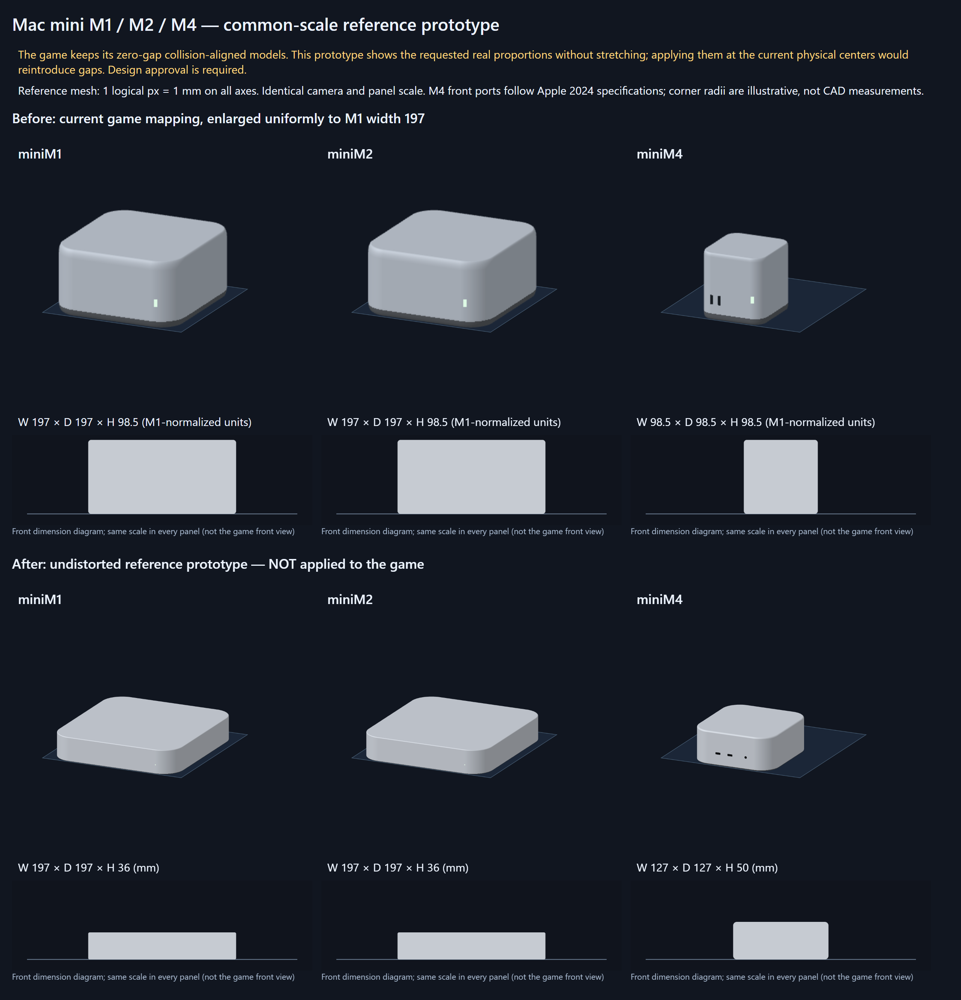

# Mac mini世代別：実寸試作と接触条件の設計判断

基準: verify-chassis-surface-contacts / a4896f4a6249a4016a04aa22bc3fd53374a2359d。
作業: mini-generation-proportions。2026-10-28（日本時間）。

## 状態：実寸試作は検証済み、ゲームへの適用は設計判断待ち

ユーザーは比較後、「物理形状の再設計を検討する（今回は変更せず、別途合意する）」を選択した。以下はそのための試作・検討資料であり、今回のゲームへの適用は行わない。

指定寸法から歪みのない世代別メッシュを作成し、同一縮尺の比較画像と数値検証を用意した。**本番のゲームモデル・物理・正面ビューは変更していない。**
現行セル寸法と実寸比が矛盾しているため、実寸モデルをゲームへ無理に引き伸ばして適用する変更は行わなかった。

M1/M2は197×197×36mmの薄い筐体、M4は127×127×50mmの小さく相対的に高い筐体。試作は全軸1px=1mmで生成する。
M4には相対的に大きい水平角丸、天面から側面へつながる6段の面取りリング、解析法線、シルバーの拡散反射・ハイライトを持たせた。面ごとの箱や正面スプライトの貼り合わせは使っていない。
角丸半径・面取り幅は外観の近似であり、Apple CAD値と主張しない。M4の前面2つのUSB-Cと3.5mmジャックは[Appleの2024技術仕様](https://support.apple.com/ja-jp/121555)で確認した。

## 同一縮尺の数値と矛盾

M1の幅を既存セルの72pxに合わせると、共通縮尺は72/197=0.36548223350253806px/mm。

| 機種 | 指定実寸 W×D×H mm | 共通縮尺の W×D×H px | 現行物理セル W×H px | 固定中心で同種を積んだ実寸モデルの隙間 px |
|---|---|---|---|---:|
| miniM1 | 197×197×36 | 72.000000×72.000000×13.157360 | 72×36 | 22.842640 |
| miniM2 | 197×197×36 | 72.000000×72.000000×13.157360 | 72×36 | 22.842640 |
| miniM4 | 127×127×50 | 46.416244×46.416244×18.274112 | 36×36 | 17.725888 |

M4/M1の幅・奥行き比は0.644670051、高さ比は1.388888889、設置面積比は0.415599474。
現行セルでは幅比0.5・高さ比1であり、指定実寸の0.644670051・1.388888889と異なる。

M1/M2を幅72px・高さ36pxの両方に一致させるには、幅方向の縮尺0.365482px/mmと高さ方向の縮尺1px/mmが必要になる。これは均一縮尺ではなく、禁止された筐体の変形に当たる。
共通縮尺でM4の幅は46.416244pxとなり、物理セル幅36pxを10.416244px超える。高さは18.274112pxで、接触する物理セルの中心間隔36pxには17.725888px足りない。
基準の正面・物理・中心位置・回転・接触面を維持したまま、歪みのない実寸モデルと物理セル/実メッシュ接触0pxを同一表示で保証することはできない。奥行きを縮めても、このXYの矛盾は解消しない。

M2は今回のユーザー指定36mmを試作入力に使った。既存公式台帳の35.8mmは変更していない。入力の丸めをゲーム用寸法へ黙って反映していない。

## 比較画像

上段は現在のゲーム用メッシュを全軸同率197/72倍し、M1の幅だけ同じ197単位に揃えたもの。下段は新しい実寸試作。カメラ・パネル縮尺は共通で、機種ごとの拡大縮小をしていない。
各3D画像の下に、奥行きの短縮投影に影響されない同じ縮尺の正面寸法図を添えた。この寸法図は比較用で、ゲームの正面ビューではない。
3Dの全シルエット高には奥行きの投影も含まれるため、高さ比の判定には寸法図・実メッシュのXYZ境界値を用いた。

## 検証

- 単体テスト: 13ファイル・204件合格。実メッシュ境界値が指定XYZ寸法に一致し、閉じた境界・単位法線・連続した面取りを検証。
- npm run build: 成功。本番ゲーム用描画や物理ソースには差分なし。
- Playwright: 実際のWebGL描画で同一縮尺の3機種と修正前/試作の比較を撮影。JS例外・console errorは0。
- 実ゲームも起動し、正面と斜めへ同一フレームを共有することを確認。
- 通常ゲームの実表面接触150ケース最大誤差は1.136868e-13px、接地24ケース最大誤差は0px。既存の0px接触を維持している。
- 実寸試作を同じ物理中心へ置けば、上表の正のギャップが出ることもテストで明示的に検証。この差を0と偽って合格にはしていない。

[寸法CSV](dimensions.csv)。生JSON、現行ゲーム画像、試作のみの画像は納品outputs/mini-generationsに保存した。

## 必要な設計選択（未承認の変更は実施しない）

**今回の選択は3。** 詳細な影響範囲・データ分離案・承認事項を[物理形状再設計の検討書](PHYSICS-DESIGN.md)に整理した。以下の1・2は比較のため残した代替案であり、採用していない。

1. **推奨：接触保証のゲーム表示と、実寸比較表示を分ける。** ゲームは現行の0px接触を維持し、歪みのない実寸モデルを別の比較パネル/図鑑で表示する。物理・操作・ルールを変えずに両方の情報を正しく提供できる。ただし、同じゲーム内モデルが両条件を満たすとの保証ではない。
2. **実寸モデルをゲームへ適用し、0px保証を物理プロキシ同士へ限定する。** モデルは歪めないが、実メッシュの隙間や物理境界との不一致を受け入れる必要がある。要件5の緩和が必要。
3. **物理形状/セルを実寸比へ再設計する。** 同一の実モデルと当たり判定を合わせるには別途ゲーム設計の見直しが必要。今回の禁止条件に当たるため、提案のみで一切実施していない。

接触グラフに合わせてモデルの中心だけを移す方法も、物理中心や物理接触点との一致を失うため無断では採用しない。密集時の閉路ではすべての接触を同時に解ける保証もない。

## 再実行

Vite開発サーバーを4173番で起動し、node scripts/capture-mini-reference.mjs を実行。MINI_OUTPUTで保存先を指定できる。
node scripts/report-mini-reference.mjs で画像・CSV・本レポートを生成する。
tools/mini/view.html は独立した診断/提案ページであり、通常画面や本番indexには組み込んでいない。
