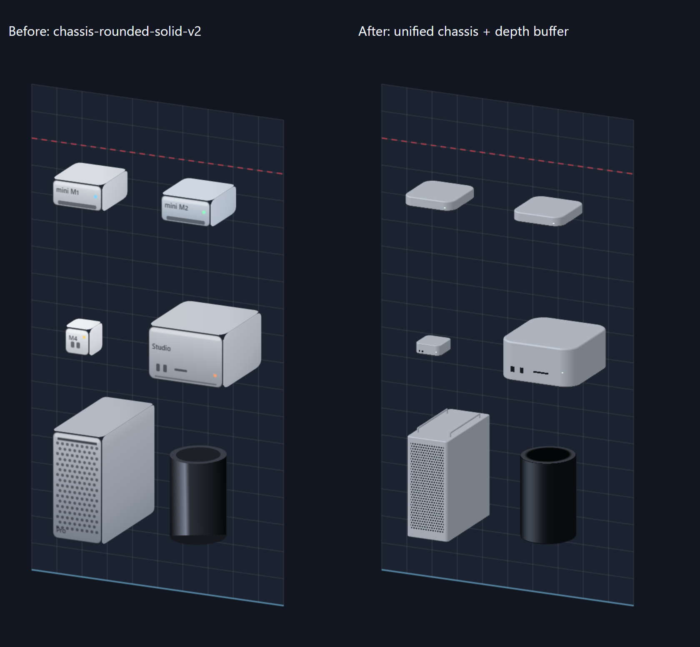
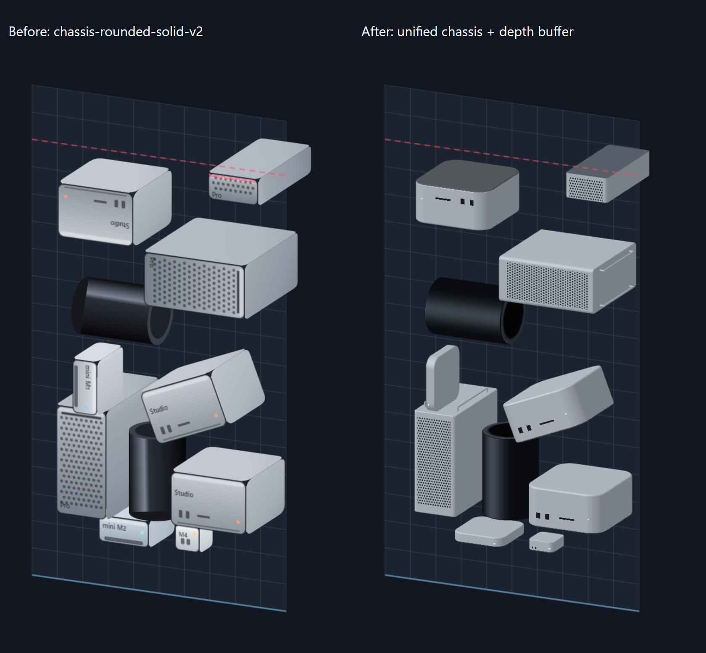

# 斜めビューの筐体再設計と検証

この文書は `oblique-unified-chassis` 作成時点の履歴です。後続の[同期精度検証](../sync-validation/README.md)で、ユーザーの選択により描画時のXY寸法と回転中心を物理セルへ一致させました。以下の寸法表はモデル空間の値であり、現在の投影後XY倍率を表すものではありません。

基準: `chassis-rounded-solid-v2` / `30d730885bc4baf6637bc9029b49240b3a9e5dc5`。
作業ブランチ: `oblique-unified-chassis`。検証日: 2026-10-27（日本時間）。

## 描画の変更

正面スプライトと個別の角丸側面を貼り合わせる処理を、斜めビュー専用の閉じたメッシュに置換した。
mini/Studioは角丸の水平断面を上下に掃引し、上下端の面取りリングも同じ輪郭と法線を共有する。
タワーは細い角丸断面、前面パンチング、筐体と同じ深度判定に参加するハンドル・脚を持つ。
Late 2013は円断面、黒い曲面反射、上端の開口リングを持つ。
角丸や材質のパラメータはイラストとしての近似であり、AppleのCAD寸法を再現したものではない。

全機種を一つの深度バッファで描き、手前の画素が奥の面を隠す。完全に同一深度の交差にだけ安定した優先順を使う。
GPUコンテキストはページ内で共用し、開閉・再開始によるコンテキスト数の増加を防ぐ。
WebGLが使えない場合やコンテキスト喪失中も、同じメッシュをCanvasのソフトウェアZバッファで描画する。
ソフトウェア描画は負荷を抑えるため内部解像度を最大400×704に制限し、輪郭のアンチエイリアスや金属反射は簡略化する。

## 実寸と投影

Apple公式仕様（リンクは下表）を再確認した。M1はM2の参考値から、M1専用仕様の高さ3.6cm・重量1.2kgへ台帳を修正した。
物理セルの幅・高さを `Gw,Gh`、公式寸法を `W,H,D` として、斜めビューだけで `s=min(Gw/W,Gh/H)` px/cmを使う。
幅・高さ・奥行きは **すべて同じs** を掛ける。旧投影の奥行き方向 `(0.42,-0.273)` は変更していない。
ワールド座標への回転後、`screenX=28+0.84*x+0.42*z`、`screenY=38+0.12*x+0.9*y-0.273*z` とする。

| 機種・公式仕様 | 幅×高さ×奥行き cm | s px/cm | メッシュ幅×高さ×奥行き px | 奥行きの画面変位 px |
|---|---|---:|---|---|
| [mini M1](https://support.apple.com/ja-jp/111894) | 19.7×3.6×19.7 | 3.655 | 72×13.157×72 | +30.240, −19.656 |
| [mini M2](https://support.apple.com/ja-jp/111837) | 19.7×3.58×19.7 | 3.655 | 72×13.084×72 | +30.240, −19.656 |
| [mini M4](https://support.apple.com/ja-jp/121555) | 12.7×5×12.7 | 2.835 | 36×14.173×36 | +15.120, −9.828 |
| [Studio](https://support.apple.com/ja-jp/111835) | 19.7×9.5×19.7 | 5.482 | 108×52.081×108 | +45.360, −29.484 |
| [Pro タワー](https://support.apple.com/ja-jp/111343) | 21.8×52.9×45 | 2.722 | 59.342×144×122.495 | +51.448, −33.441 |
| [Pro Late 2013](https://support.apple.com/ja-jp/112025) | 16.7×25.1×16.7 | 4.303 | 71.857×108×71.857 | +30.180, −19.617 |

タワーの幅と奥行きは、高さ144px内で実寸比を保つため同じ比率で小さくなる。奥行きだけを潰す処理はない。
既存ゲームのセル比率は実寸比と一致しないため、斜めビューのシルエットはセル内で底辺揃えにしている。
その結果、mini等には当たり判定矩形との余白がある。斜めビューは実寸比を優先する参考表示で、接触判定・操作位置は従来どおり正面ビューが基準。
断片は親機種のsと奥行きを維持し、切断された端には元の丸いリップやハンドルを付けない。

## 画像の確認

同一のRenderItem座標・角度・断片条件で基準実装と新実装をPlaywrightから描画した。
ゲーム自体も起動し、LIVE同期された正面・斜めビューを撮影した。

- mini M1/M2/M4: 薄いアルミ筐体、天面から前面・側面へ連続する角丸を目視確認。
- Studio: miniより厚い本体、同じ輪郭に沿うポートと面取りを確認。
- タワー: パンチング面と側面の接続、上部レール、脚を確認。
- Late 2013: 黒い円筒の曲面反射と開口部を、直立・横倒しで確認。
- 密集状態: 前面スプライトが奥の物体を突き抜ける現象や、面の継ぎ目に背景が見える現象を解消。投入配列を逆転しても画素一致。
- WebGLを無効化した場合も各機種と密集状態を確認。ソフトウェア経路も配列逆転で画素一致。
- 正面の同一状態fixtureは修正前後でPNGのSHA-256が一致:
  `68ae1d4932a338a4706be517d955428bf64c69e88cc9f702d579a385ba9429d7`。

## 維持した機能とテスト

Matter.js、Simulation、正面Renderer/Sprite、入力、スコア、ゲームルールは変更していない。
同一RenderStateを同一フレームで渡す既存のLIVE同期も維持する。

- `npm test`: 10ファイル・89件すべて合格。
- `npm run build`: TypeScriptとViteの本番ビルド成功（JS 380.53 kB / gzip 122.56 kB）。
- 本番preview（4180番）に対するPlaywright最終実行: **9 passed / 9 skipped、44.0秒、終了コード0**。skipはPC専用テストをモバイルで実行する場合などの明示的な対象外指定。
- Playwright: PC/モバイルの操作、LIVE同期、回転、行消し、停止、ゲームオーバー、スコア保持を確認。
- 追加E2E: GPU/Canvasの両経路で18回開閉。停止中の物理ステップが変わらず、GPUコンテキストが1個のままであることを確認。
- 既存開閉テストの「100ms後の落下量<40px」という時間依存の判定は、停止中の座標・ステップ数・台数一致に置換。入力の漏れを直接検証する。

検証環境はWindows、Node 22.18、Chromium。サンドボックスでネイティブesbuildが親ディレクトリを列挙できないため、ローカルnode_modules内だけで同バージョン0.28.2のesbuild-wasm APIを使用した。package.jsonとlockfileには変更を加えていない。

通常の再検証は `npm ci`、`npm test`、`npm run build`、`npm run test:e2e -- --workers=1`。
既存開発サーバーを再利用させず、本番previewでE2Eを実行すること。
画像再取得はVite開発サーバーを4173番で起動し、`node scripts/capture-oblique.mjs after`。
`FORCE_SOFTWARE=1`でCanvas経路を撮影する。`CAPTURE_OUTPUT`で保存先を指定できる。
基準実装を同じサーバー条件で `before` として取得してから `node scripts/compare-oblique.mjs` を実行すると比較画像と正面一致の検証結果を生成する。

## 変更ファイル

- `src/game/rendering/obliqueRenderer.ts`: スプライト貼り合わせを廃止し、統合描画を合成。
- `src/game/rendering/chassisMesh.ts`: 実寸比、角丸断面、面取り、円筒、ハンドル・脚。
- `src/game/rendering/chassisRenderer.ts`: 材質、ポート、パンチング、共有GPU深度バッファ。
- `src/game/rendering/softwareChassis.ts`: WebGL非対応時のソフトウェア描画。
- `src/data/officialDimensions.ts`: M1の公式寸法・出典を確認して更新。
- `src/tests/chassisMesh.test.ts`: 実寸倍率、閉じた境界、法線、断片、状態不変の14テスト。
- `e2e/dual-view.spec.ts`: 開閉時の入力漏れを停止状態で検証。
- `e2e/chassis.spec.ts`: GPU/Canvas描画と繰り返し開閉の検証。
- `scripts/capture-oblique.mjs`: ゲーム・各機種・密集シーンと正面fixtureの取得。
- `scripts/compare-oblique.mjs`: 比較画像・正面ハッシュ・投入順不変の検証。
- `docs/oblique-validation/README.md`、`comparison-models.png`、`comparison-dense.png`: 本記録と比較画像。
