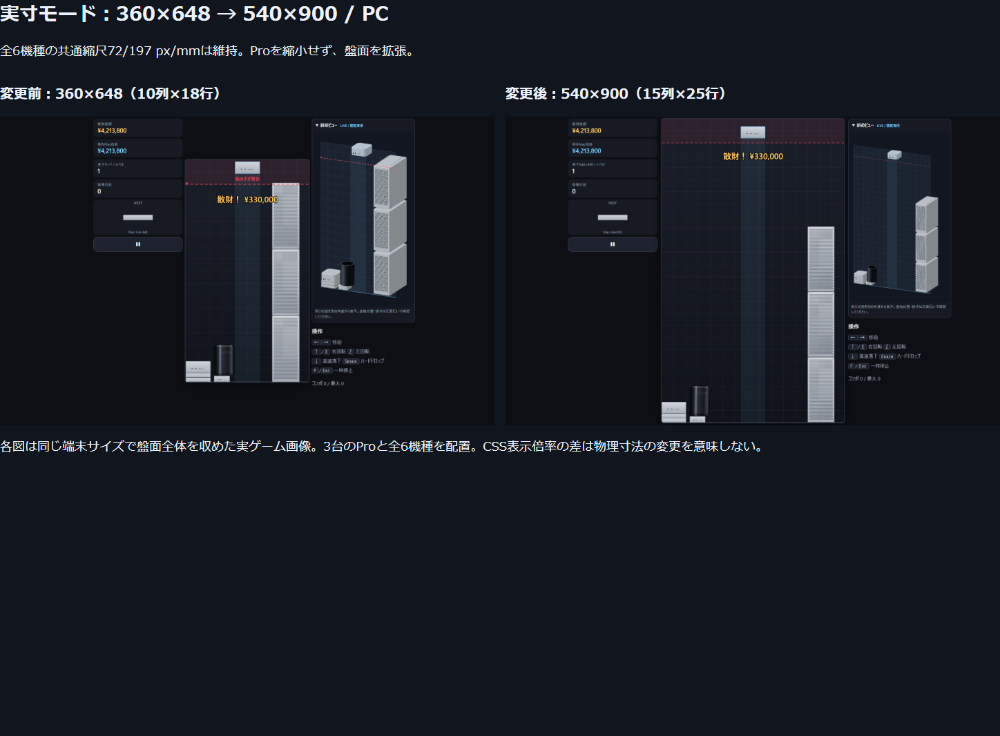
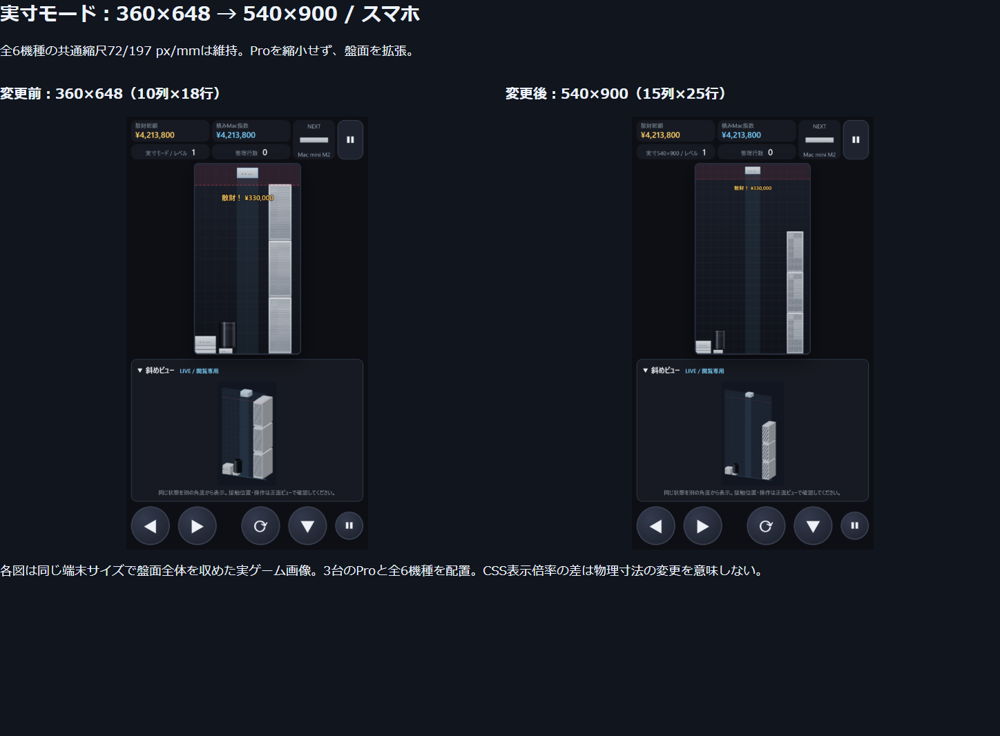
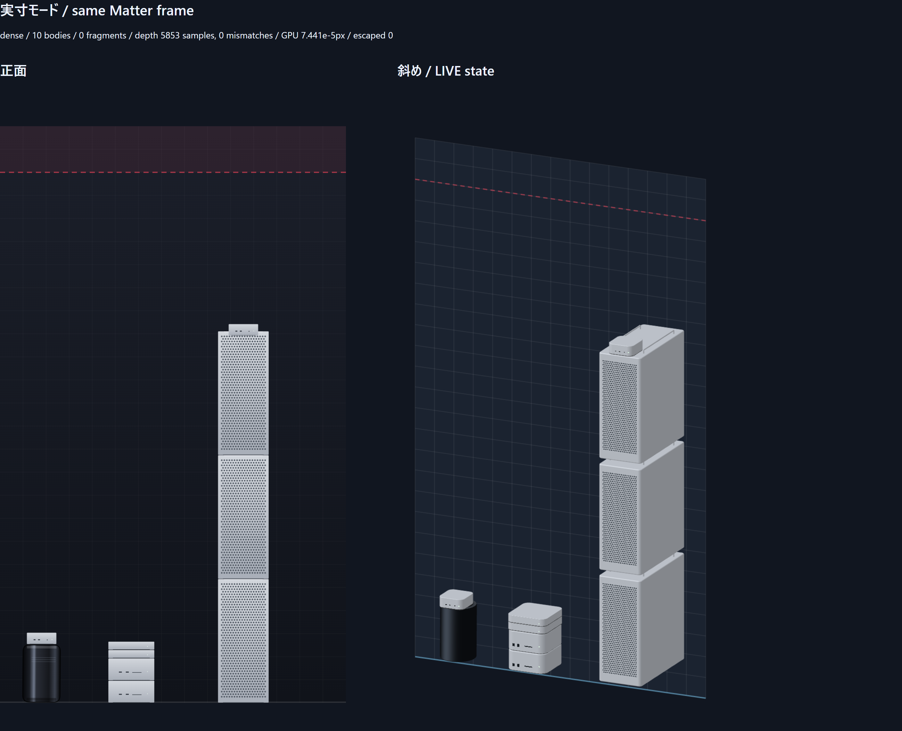
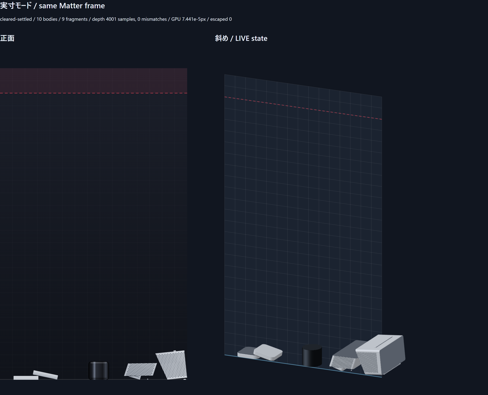

# 実寸モード専用盤面 540×900

基準: `real-scale-game-mode` / `3fccac4de9b944b6dcbf0cf1b5d4c54198f03eb3`。
新規ブランチ: `real-mode-board-540x900`。2026-10-28（日本時間）。

実寸モードのみ物理盤面を540×900px（36pxセル・15列×25行）へ拡張した。タイトルから通常どおり実寸モードを開始できる。現行モードは360×648px（10列×18行）のまま。mainと基準ブランチは変更していない。

## 実装

- `src/game/board.ts`をモード別の盤面定義とし、GameSim、Matterの壁/床、占有判定、正面・斜め描画、画面サイズ計算へ渡す。物理領域、移動・壁際回転・盤外監視、行エフェクトまで同じ寸法を参照する。
- 実寸モードの床はy=900、左右壁の内面はx=0/540。出現中心はx=270。危険ラインは従来どおり上から72px、継続2秒でゲームオーバー。出現場所が塞がった場合の終了判定も新中心へ対応した。
- 行成立は15列すべての面積占有率で判定する。旧10列だけを埋めても消えない。任意の凸多角形による行消し・断片化は既存実寸モードの処理を維持し、最下段のrow=24も扱う。デバッグ用消去APIの行範囲も25行へ対応した。
- 全6機種の実寸値、角丸・面取り・材質・奥行き、共通縮尺 **72/197 px/mm** は変更していない。Proは **79.675127×193.340102×164.467005px（幅×高さ×奥行き）** のまま。物理の4サブステップ、質量、速度、摩擦、スコア式も維持した。
- 正面は540:900を保ってステージ内へ同率縮小する。PCは中央列の最大幅540pxとし、画面の高さが足りなければ盤面全体を縮小する。スマホも利用可能な幅と高さへ収め、タッチ操作・斜めパネルを維持する。
- 斜めビューは論理キャンバスを600×1000へ拡大した。カメラの線形投影係数とモデル寸法は同じで、上下の余白確保のため描画Yのみ36px平行移動する。床、危険ライン、ガイド、WebGL筐体、Canvas筐体に同じ変換を使う。物理座標・回転中心は変更しない。
- 旧通常記録 `tsumimac.highscore.v1`、旧実寸記録 `tsumimac.highscore.v1.real` はそのまま残し、新盤面の実寸記録を **`tsumimac.highscore.v1.real.540x900.v1`** へ保存する。自動移行・上書き・旧記録との比較は行わない。設定キーは共通のまま。

## 検証

- `npm test`: **15ファイル・249件合格**。旧実寸テストの床・列数の前提を新盤面へ更新し、専用14件を追加した。
- `npm run build`: 成功。検証ツールもstrict TypeScript検査成功。
- 本番ビルドに対するPlaywright: **17件合格・失敗0・対象外11件スキップ**。追加6ケースはPC/スマホ双方でWebGL/Canvasの全盤面表示、Pro複数台、最下段切断、同一フレーム同期、ゲームオーバー、別記録保存、再挑戦、移動/回転/ハードドロップを検証する。スマホ横向きの盤面・左右タッチボタンも確認した。
- 全6機種で新中心から左右の壁へ移動し、壁際で4方向に回転、右側の拡張領域から落下して新しい床へ接地することを検証した。旧床y=648で止まらない。
- 旧10列のみの行が成立しないこと、15列目を含む最下段の自然な行成立・切断・再接地・価値台帳保存を確認。傾いたProのrow=24切断も実メッシュ頂点で消去帯の不在を検査した。
- Pro 3台を1200物理フレーム積んでも、個体数3・盤外逸脱0・実寸保持・接触誤差0.2px未満。Pro 5台の高い山を使うPC/スマホの実画面でも終了・保存・再挑戦が正常に動く。
- 正面と斜めは同じRenderState参照を共有し、座標・角度・断片が完全一致する。実GPU頂点シェーダーによる全6機種×7角度×3位置×5点、計630点の最大投影誤差は **0.000074410999px**。上部・右端・下部を含む位置を照合した。
- 密集/行消し直後/行消し後500フレームを含む5シーンをWebGLとCanvasで撮影。深度監査はWebGL **10,890点**、Canvas **11,149点**の重なりで不一致0。描画順を反転しても画素一致。盤外逸脱0、価値台帳誤差0、JS/console error 0。
- 全6機種×直立/90度の床誤差は+0.012500000002px、mini積層の面間隔誤差は−0.010044086524px。従来の約23pxの隙間を再発させていない。これはソルバー許容差を含む実測値であり、厳密な浮動小数点0pxとは主張しない。
- 現行モードの正面固定状態画像SHA256は **68ae1d4932a338a4706be517d955428bf64c69e88cc9f702d579a385ba9429d7**。基準と完全一致。既存の現行モードテストも維持した。

数値・座標は [measurements.json](measurements.json)。各GPU測定点と全画像は納品outputs/real-board/auditに保存する。

## 比較画像

比較は同じ端末サイズ・同じ共通縮尺・同じ9個体（操作対象1台、全6機種を含む固定8台、うちPro3台）を各盤面の床から配置した。盤面全体を表示するCSS倍率は異なるので、画像上のProサイズだけで物理縮小とは判断しない。幅・高さ・奥行きの実メッシュ寸法を単体テストで検証している。

## 再現・残る制約

`npm test`、`npm run build`、`npm run test:e2e`。本番検証はpreviewを4183に別起動し、PlaywrightのbaseURLをそのポートへ向けた。PC/スマホ比較は `BOARD_URL=http://localhost:4183`、`BOARD_OUTPUT`を設定して `node scripts/capture-board.mjs after`。基準コミット側を別起動してbeforeも取得し、`node scripts/report-board.mjs`で比較図を生成する。

幾何監査は開発サーバー4173の `tools/real/view.html?scene=dense` 等。`REAL_OUTPUT`を指定して `node scripts/capture-real-mode.mjs`、Canvas代替は `REAL_SOFTWARE=1`。撮影ハーネスは対象個体数・同一フレームも検査し、撮影前に未描画の配置が残らないようにしている。

Matterは2Dで奥行き方向の接触は扱わず、角丸端部には物理プロキシとの近似差がある。正常な奥行き投影による見え方の差は残る。盤面拡張による難易度変更は意図した仕様で、旧実寸記録と比較しない。画面の小さいスマホでは盤面全体の縮小表示となる。

このWindows環境では保護された親フォルダをnative esbuildが走査できないため、既存ローカルのesbuild-wasm代替でビルドした。package.json/lockへこの環境依存変更は含めていない。
