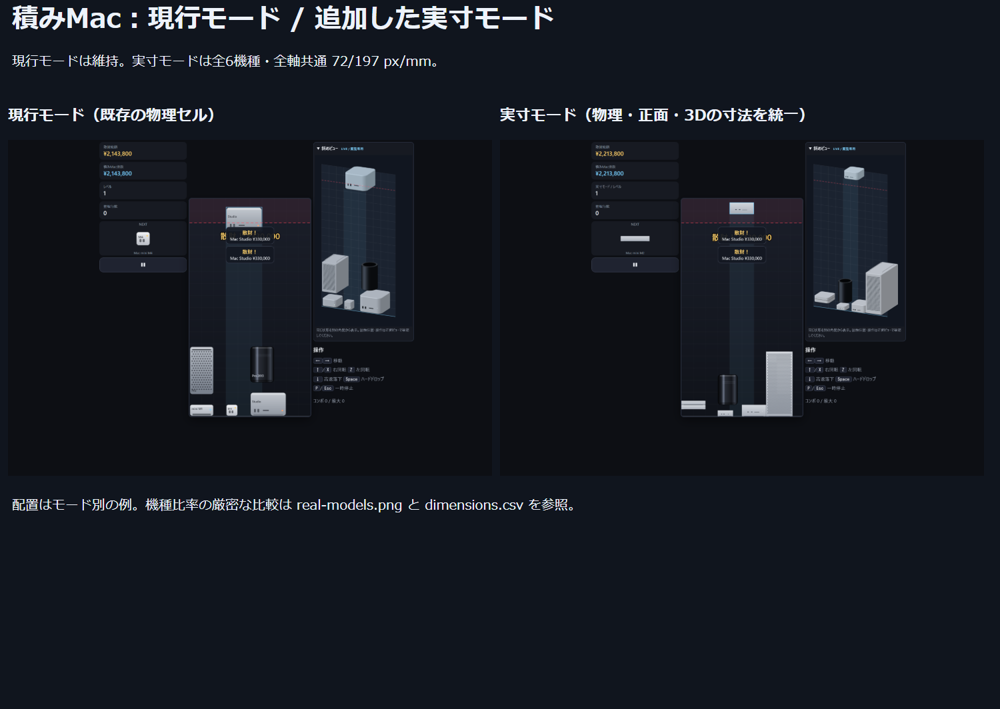
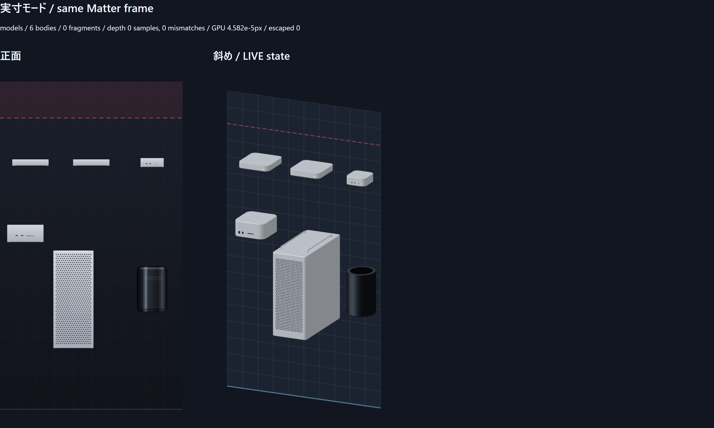
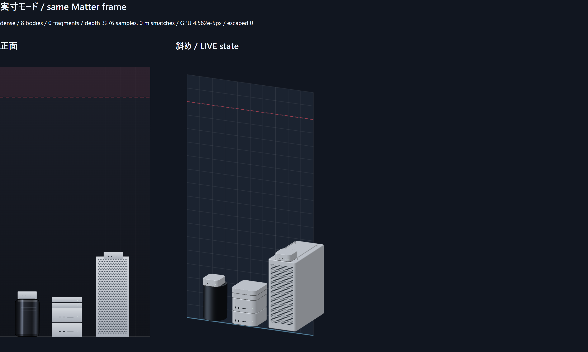
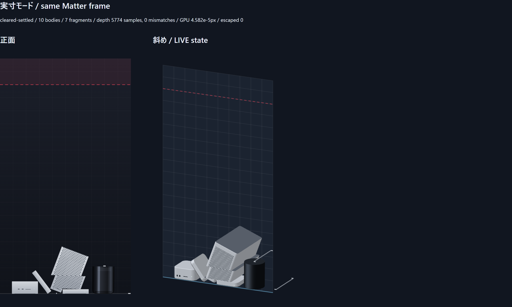

# 実寸モード：実装・実画面検証

基準 `mini-generation-proportions` / `5b1bd8b39019fa2c01465a56fea5bea4a0437cf4`。
新規ブランチ `real-scale-game-mode`。2026-10-28（日本時間）。

タイトルの「実寸モードで積む」から遊べる独立モードを追加した。現行モードの物理サイズ、描画、スコア式、保存キーは維持する。過去の実寸試作をゲーム用物理へ適用し、実寸モードに限り正面も同じ寸法へ変更した。

## 全機種共通の縮尺

全軸・全機種で `72/197 = 0.36548223350253806 px/mm`。機種別の引き伸ばしや奥行き短縮はない。物理ボディと両ビューが同じ中心、角度、幅、高さを使う。3DのZだけに別倍率を使わない。

| 機種 | 幅×高さ×奥行き mm | 幅×高さ×奥行き world px |
|---|---|---|
| Mac mini M1 | 197×36×197 | 72×13.157360×72 |
| Mac mini M2 | 197×36×197 | 72×13.157360×72 |
| Mac mini M4 | 127×50×127 | 46.416244×18.274112×46.416244 |
| Mac Studio | 197×95×197 | 72×34.720812×72 |
| Mac Pro tower | 218×529×450 | 79.675127×193.340102×164.467005 |
| Mac Pro Late 2013 | 167×251×167 | 61.035533×91.736041×61.035533 |

M4/M1の幅・奥行き比は0.644670051、高さ比は1.388888889。M1/M2の高さは旧セル36pxではなく13.157360pxとなる。実メッシュXYZ境界値とMatterのXY境界値も単体テストで検証した。

寸法出典は既存の公式台帳 `src/data/officialDimensions.ts`。M1 [Apple仕様](https://support.apple.com/ja-jp/111894)、M2 [Apple仕様](https://support.apple.com/ja-jp/111837)、M4 [Apple仕様](https://support.apple.com/ja-jp/121555)、Studio [Apple仕様](https://support.apple.com/ja-jp/111835)、Pro [Apple仕様](https://support.apple.com/ja-jp/111343)、2013 [Apple仕様](https://support.apple.com/ja-jp/112025)。M2はユーザー指定の丸め値36mmを採用した（公式35.8mmとの差0.2mm=0.073096px）。重量、価格、摩擦は既存のゲーム用パラメータを維持する。

## 物理・行消し・互換性

- 薄いminiを安定して積むため、実寸モードのみ1フレームを4物理サブステップに分割した。重力、Matterのソルバー設定、現行モードのステップ数は維持する。
- Mac Proは外接矩形だけの当たり判定をやめ、胴体、上部レール、脚の複合ボディを使う。小さいM4が取っ手の間に入ると筐体へ接触し、架空の上面に浮かない。
- 36pxの行グリッドと既存の面積占有判定を維持する。実寸は整数セルへ丸めない。移動は従来の36px単位を使い、端の移動を壁へクランプする。回転は物理中心を基準にして壁キック・衝突を確認する。
- 行消しは回転済みの実際の凸多角形を横方向の消去帯で切断する。断片の重心、輪郭、元モデルからのオフセットを保持し、Matter、正面のクリップ、3Dメッシュの切断面を同じ形状へ揃える。
- Proの脚・レールを別々に切断して蓋を作り、離れた脚同士を結ぶ架空の薄板を防いだ。断片の再切断でも面積比例の価値合計を保存する。
- 数値的に不安定な微小断片（面積0.1px²以下、またはXY外接寸法0.5px未満）は消去側へ計上する。
- 現行ハイスコアは `tsumimac.highscore.v1`、実寸モードは `tsumimac.highscore.v1.real`。設定は共有。旧保存JSONを読み書き変更せず、実寸記録を別保存する。再挑戦・一時停止からのリスタートも選んだモードを保つ。

## 検証結果

- `npm test`: 14ファイル、235件合格。新規31件で全機種XYZ寸法、直立/90度の落下、薄型積層、Pro上のM4、壁際回転、0/90/180/270度と傾斜角での切断、自然な行成立、再切断の価値保存、旧セーブ互換を確認。
- `npm run build`: 成功。検証用 `tools/real/view.ts` も別途strict TypeScript検査成功。
- 本番ビルドに対するPlaywright: 11件合格、11件はPC/モバイルの対象外として明示的スキップ。失敗0・再試行0。現行操作と実寸操作、同期、断片、リスタート、モバイル展開/タッチを実画面で確認。
- WebGLとCanvas代替描画の各5シーンをPlaywrightで撮影。通常・90/180/270度/傾斜・密集・行消し直後・行消し後500ステップを確認。JS/console error 0、盤面外逸脱0、価値台帳の誤差0。
- 実GPU頂点シェーダーとCPU投影の最大誤差 **0.000045824347px**（42状態×5点）。両ビューは同じRenderStateオブジェクトを使用。描画順を逆にしても画像一致。
- 深度監査: WebGL計11,597点、Canvas計11,960点の重なり部分で可視面不一致0。MSAAの境界画素を除外し、単体描画の色と最前面三角形の深度を照合した。
- 全6機種×直立/90度の床との誤差は **+0.012500000002px**（微小なソルバー貫通）。mini2台の面間隔誤差は **−0.010044086524px**。旧セルと実寸モデルの差による **22.842640pxの隙間は解消**した。厳密な浮動小数点0pxと偽らず、設計上の接触一致とソルバー許容差を分けて報告する。
- 現行正面の固定状態画像SHA256は `68ae1d4932a338a4706be517d955428bf64c69e88cc9f702d579a385ba9429d7`。基準画像と一致し、現行モードの見た目を維持する。

座標・角度・誤差は [measurements.json](measurements.json)、寸法は [dimensions.csv](dimensions.csv)。GPUの各点の生データを含む大きいJSONと全シーン画像は納品outputs/real-modeに保存した。

## 比較・実画面

左右は各モードのゲーム例で、配置は同一ではない。変更前の現行モードは上記画像ハッシュで不変を検証した。全機種の厳密な寸法比較は次の同一縮尺図を参照する。

上段はM1・M2・M4、下段はStudio・Pro・2013。奥行きの投影が見かけの画面高さに加算されるため、実際の高さ比は正面とXYZ数値で検証する。

行消し後の細い金属棒は切り離されたProの取っ手/脚で、物理ボディを持つ断片。描画だけの浮遊面ではない。

## 再現と制約

`npm test`、`npm run build`、`npm run test:e2e`。寸法/密集/切断の撮影は開発サーバー4173で `node scripts/capture-real-mode.mjs`、Canvasは `REAL_SOFTWARE=1`。比較レポート生成は現行画像を `scripts/capture-oblique.mjs classic` で同じ出力先のclassic/へ保存後、`node scripts/report-real-mode.mjs`。`REAL_OUTPUT`で出力先を設定する。`tools/real/view.html?scene=dense` 等で同一フレームの検証画面を表示できる。

Matterは2Dで、奥行き方向の転がり・接触は扱わない。mini/StudioはXY矩形、円筒は小さい面取り付きの側面形、Proは複合形で近似する。見た目の角丸/面取りの端はその外接物理形状と完全一致しない場合がある。正常な奥行き投影による重なりは残る。行の高さとスコア式は維持しているため、実寸モードの積みやすさ・行消し頻度は現行と異なり、記録を分けた。全配置で厳密な0pxの隙間/貫通を保証するものではない。

本環境のビルドは保護された親フォルダをnative esbuildが走査できないため、既存ローカルのesbuild-wasm代替を使用した。package.json/lock、配布コードにはこの環境対応を含めていない。Playwrightはインストール済みChromiumを指定し、外部で起動したpreviewポート4183へ接続した。
