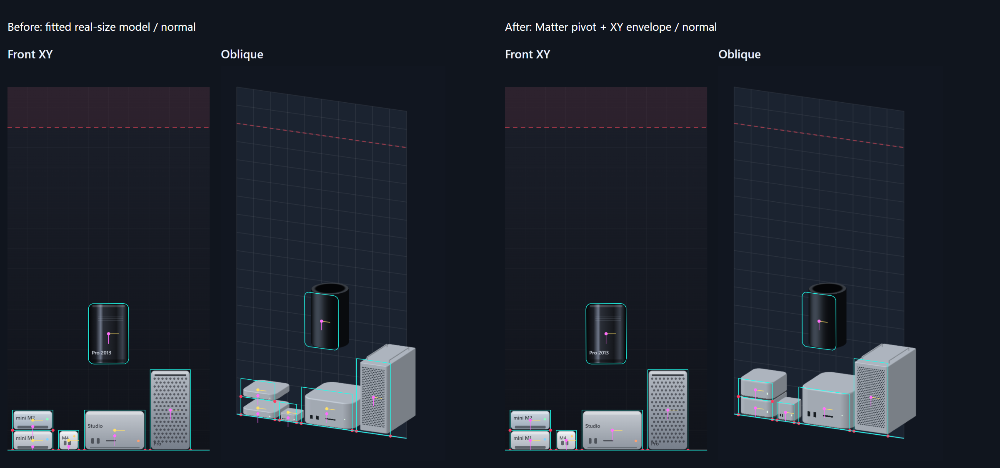
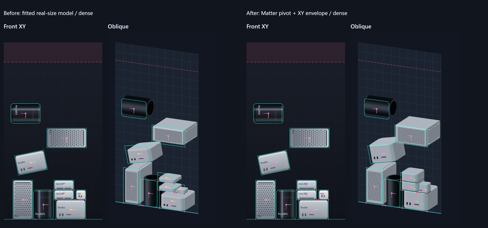
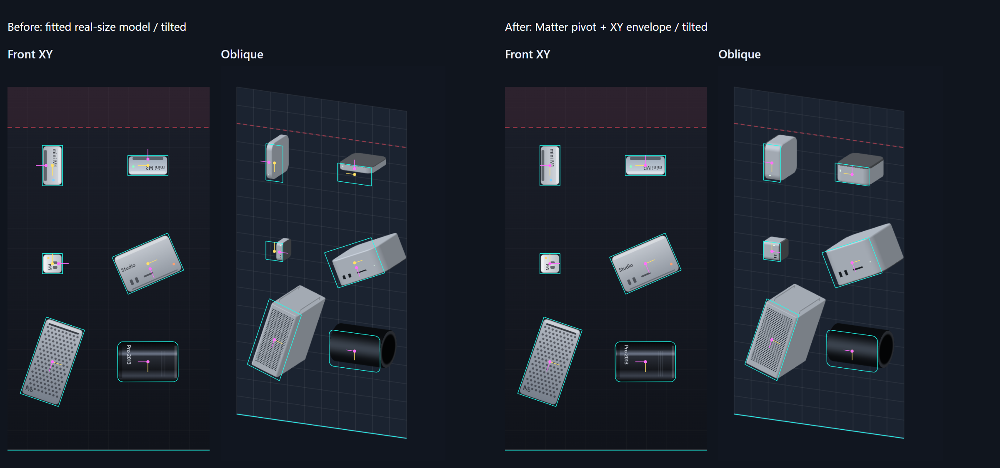

# 正面・斜めビューの同期検証

基準: oblique-unified-chassis / 18ac602fbb17e232408d6d464d5eaaf732961d98。作業: verify-oblique-physics-sync。2026-10-27（日本時間）。

## 判定と修正範囲

**Matter状態の共有・回転方向・投影式・深度バッファに不具合は見つからなかった。表示モデルの中心とXYサイズが物理セルからずれる対応方針を修正した。**

基準実装は公式寸法比でセル内に収めた筐体をローカルYの底辺に寄せていた。mini M2は物理高さ36pxに対しモデル高さ13.084264pxで、中心が11.457868pxずれ、上下のモデル間に22.915736px（角度0の画面上では20.624162px）の隙間が生じた。回転時にはこの中心ずれも回転する。

ユーザーの選択「物理セルとの位置・サイズ・接触一致を優先する」に従い、描画時にXYを物理セルの幅・高さへ合わせ、中心オフセットを除去した。これは公式寸法比をすべての軸で保つ方式からの意図的な変更で、miniの厚み等はゲームのセル比率になる。モデルの頂点形状・材質係数・装飾、Z寸法は変更していない。異方性のXY倍率に伴う法線の逆転置行列だけを適用した。

正面Renderer/Sprite、Matter.js設定、GameSim、GameEngine、入力、スコア、ルール、FrameViewsは変更していない。正面の生PNGは通常・密集・傾斜・非接触の全4fixtureで修正前後のSHA-256が一致した。

## 数学と測定方法

物理ローカル座標を先にR(θ)で回し、物理中心(x,y)へ移し、それから投影する。XY写像は [[0.84,0],[0.12,0.9]]、行列式0.756で向きを反転しない。

- screenX = 28 + 0.84 × worldX + 0.42 × Z
- screenY = 38 + 0.12 × worldX + 0.9 × worldY − 0.273 × Z
- モデル座標からのXY倍率: sx = 物理幅 / モデル幅、sy = 物理高さ / モデル高さ。物理中心を回転中心にする。
- GPU・ソフトウェア描画・デバッグ表示で同じ変換定義を利用。GPU側の式もこのカメラ定数から生成する。

6機種×7角度（0°、90°、180°、270°、−23.49°、18.91°、360°）の42状態を検証。実際のGameSim/Matterの位置・角度・頂点を読み、RenderStateと独立の算術参照を照合した。実際の頂点シェーダーをGLSL 300の構文にだけ変換し、transform feedbackで5点×42状態=210点のGPU出力を直接読み出した。画面ピクセル中心の丸めを測定誤差に含めていない。

| 測定 | 最大値 |
|---|---:|
| Matter → RenderStateの中心差 | 0.000e+0 px |
| Matter → RenderStateの角度差 | 0.000e+0 rad |
| 修正後モデル基準点と物理中心の差 | 0.000e+0 px |
| 物理頂点の座標系変換誤差 | 6.355e-14 px |
| 回転復元誤差 | 4.737e-15 rad |
| GPUシェーダーと倍精度参照の差 | 0.000041 px |
| 同一深度の接触包絡線基準点の差 | 1.137e-13 px |

| 機種 | 基準点と物理中心の差 px：前→後 | 接触包絡線の最大画面差 px：前→後 | 回転誤差 rad |
|---|---:|---:|---:|
| miniM1 | 11.421320 → 0.000e+0 | 21.363226 → 1.137e-13 | 3.308e-15 |
| miniM2 | 11.457868 → 0.000e+0 | 21.431589 → 1.137e-13 | 3.308e-15 |
| miniM4 | 10.913386 → 0.000e+0 | 20.413151 → 1.137e-13 | 3.798e-15 |
| studio | 9.959391 → 0.000e+0 | 18.628733 → 2.842e-14 | 3.331e-16 |
| pro | 0.000e+0 → 0.000e+0 | 11.392060 → 6.355e-14 | 4.737e-15 |
| macPro2013 | 0.000e+0 → 0.000e+0 | 0.129084 → 5.684e-14 | 3.308e-15 |

投影後の軸角は0°→約8.13°、90°→90°、180°→約188.13°、270°→270°となる。正面との見た目の角度差は剪断を含む投影による正常な差であり、修正しなかった。Rと投影行列を交換してはいけない。

## 接触と深度

6機種×6角度の上下・左右接触基準点を数値検証した。さらに各機種4象限について実際に300物理ステップ進め、24状態の接地・Matter位置/角度と描画状態の一致を記録した。接地頂点の床への最大食い込みは0.050000px。これは既存Matterソルバーの許容差であり、描画同期の誤差ではない。速度分だけ広がるbroad-phase boundsを接触面の代わりに使わず、実頂点を測定した。

実際の生産用シェーダーで合成した画像を、各機種単体の描画色と独立した三角形レイ交差のZ計算で照合した。前面所有者が3×3近傍で安定し、深度差0.1px以上・識別可能な色差がある内部画素を採用。MSAAで複数物体の色が混ざる境界画素は対象外にした。単なる投入順反転一致だけで深度の正しさを判断していない。

| 配置 | 判定可能な重なり画素 | 誤った所有者 | 最大色差 byte |
|---|---:|---:|---:|
| normal | 2939 | 0 | 0 |
| dense | 5844 | 0 | 0 |
| tilted | 0 | 0 | 0 |
| separated | 690 | 0 | 0 |

Canvas代替描画も同じ試験を実施し、密集配置6035画素で誤り0。投入順を逆転しても全fixtureの画像は一致した。

非接触fixtureではMatter矩形は横8px・縦5px離れ、接触支持点は0個。それでも3D画像は重なる。投影の核は(−0.5,+0.37,+1)なので、離れた3D点が同じ画素に重なることは正常である。Zの小さい物体が手前に描かれる690画素を確認し、この重なりを取り除く変更はしていない。

## 画像・データ

デバッグは開発用の tools/sync/view.html でのみ表示される。正面製品コードには追加していない。シアン=実Matter輪郭と床、赤=実支持点、黄=物理中心とX軸、紫=モデル基準点とY軸。黄と紫が重なると基準点一致。接触支持点はZ=0の物理面へ投影したもの。

fixtureは同じMatter timestamp=0で凍結した測定配置。接触支持点を得るため、接触fixtureには0.02〜0.06pxの既知の微小食い込みがある。別途、上記300ステップ後の動的な接地状態と、実ゲームを起動して停止した同一フレームの共有も確認した。傾斜fixtureの物体は測定用に静止させた配置で、落下後の安定解を装っていない。

数値の全行: [物理座標・投影](projection.csv)、[接触](contacts.csv)、[GPU出力](gpu.csv)、[接地後24状態](settled.csv)。完全なbefore/after/softwareのJSONと非接触fixture画像、実ゲーム画像は納品outputs/syncに保存した。

## 残る制約

- 3Dは2D物理の可視化であり、Z方向の接触や奥行き方向への転倒を解く3D物理ではない。投影像の重なりだけから物理接触を判定することはできない。
- 角丸、面取り、タワーの脚・ハンドル、円筒表面はMatterの矩形/角丸矩形と完全に同じ表面ではない。今回一致させたのは回転中心・XY包絡線・同一Zでの接触基準座標であり、輪郭の全画素一致を主張しない。円筒の横倒しでは実際の接触母線がZ=半径の位置にあり、Z=0の床線より奥に見えるのは正常。
- 正面だけの画面揺れ・フロート表示等の演出は維持した。測定fixtureはshake=0で比較した。
- 物理セル優先のため、投影されたXY寸法は公式寸法比と一致しない。奥行きは従来値のままで、今回は短縮していない。

## 再実行

最終確認: npm testは11ファイル・176件合格。本番ビルド成功。Playwright本番E2Eは9件合格・端末条件による対象外9件。別途、本診断のPlaywright測定をGPU/Canvasの両経路で実行した。

npm test / npm run build。Playwrightの通常E2Eは本番previewに対して実行する。
Vite開発サーバーを4173番で起動して node scripts/verify-sync.mjs after、SYNC_SOFTWARE=1でsoftwareとして再実行。
SYNC_OUTPUTで出力先を指定できる。beforeは基準の底辺寄せ(sx=sy=1)で取得したものと比較する。node scripts/report-sync.mjs でCSV・比較画像・本レポートを生成。
開発診断ページは本番indexから参照されず、本番バンドルへ含まれない。片方のビューだけ別の物理ループを起動する処理はない。
