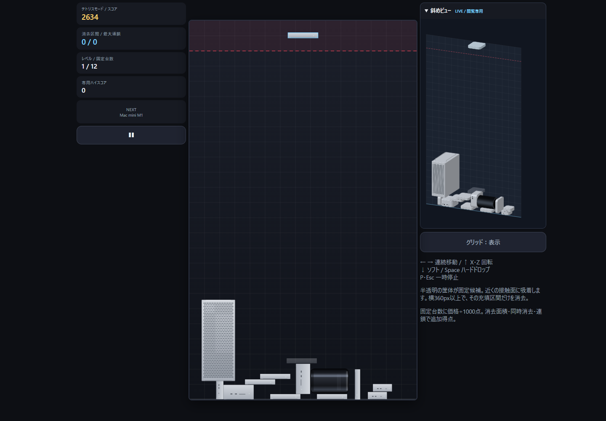
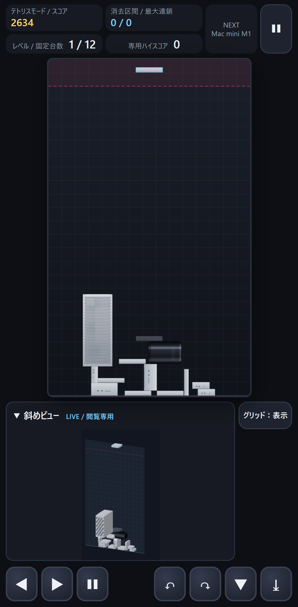
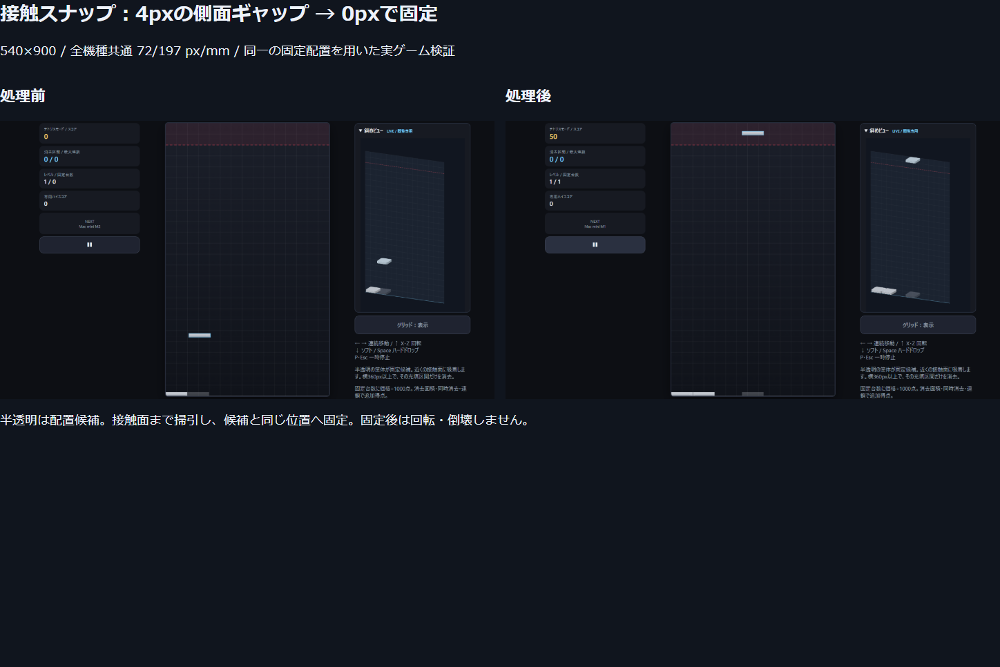
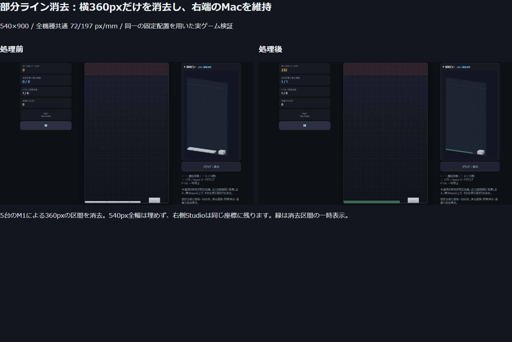
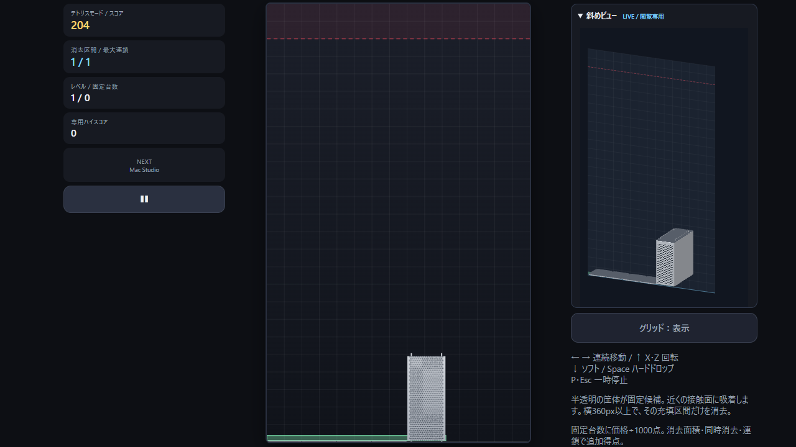

# テトリスモード：完成版と検証

基準: `real-mode-board-540x900` / `5a72e1acd2c9eb0ba58e3a8642893b225eddf748`。
新規ブランチ: `tetris-snap-mode`。2026-10-28（日本時間）。

タイトルの「テトリスモード」から遊べる独立モードを追加した。専用のTetrisSim / TetrisEngineが配置・落下・消去・再固定・連鎖を処理する。Matter.jsを呼び出さない。既存2モードの物理・盤面・スコア・記録の実装は変更していない。

## 盤面・操作・スナップ

盤面540×900px。全6機種に既存実寸モードと同じ **72/197 px/mm** を適用し、幅・高さ・奥行きと世代別メッシュを維持する。36pxは補助グリッドだけで、配置の整数丸めには使わない。M1/M2は72×13.157360×72px、M4は46.416244×18.274112×46.416244px、Proは79.675127×193.340102×164.467005px（幅×高さ×奥行き）。

- ←/→で連続移動（初回6px、保持中180px/秒）。↑/Xで右90度、Zで左90度回転。↓でソフトドロップ、Spaceでハードドロップ。P/Escで一時停止。
- スマホにも左右移動・左右回転・ソフト/ハードドロップ・一時停止の全ボタンを用意した。グリッド切替は両ビューへ同時に反映する。
- 落下先は凸多角形の掃引SATで求める。最初の接触で止まり、大きな落下量でも薄いMacをすり抜けない。
- 10px以内の側面・同じ端面・壁の吸着候補を列挙し、衝突しない移動経路と固定位置を検査する。重心が支持点の範囲内にある候補を優先し、その中で横方向の補正量が小さい候補を選ぶ。同距離なら落下距離が小さいものを選ぶ。適切な近傍面がなければ現在のXから落下する。
- Proは胴体・取っ手・脚の複合輪郭、2013は小さい面取り付きの円筒側面輪郭を使う。M4はProの取っ手の間へ入り、胴体へ接触できる。
- 半透明の筐体は固定候補。正面・斜めに同じ座標と角度で表示する。ハードドロップ、または接触後250msで、その候補へ固定する。
- 固定済みMacは通常フレームでは移動・回転しない。消去によって支持を失ったものだけ、消去処理の中で下方へ掃引して再固定する。倒壊や重力による回転は起こらない。

## 部分ライン消去の定義

Macの凸多角形を頂点の高さで水平帯へ分割し、帯の上端と下端の連続した横断面の共通部分を調べる。**高さ0.5px以上の帯で横360px以上を連続して満たす区間**を消去する。薄いminiも実寸のままラインを構成でき、540px全幅や36px単位の高さを埋める必要はない。

許容隙間は既定 **0.25px/箇所**、区間長にも0.25pxの許容を使う。`DEFAULT_LINE_RULES`および各Simの`rules`で変更できる。359px・359.74pxは不成立、359.8pxは既定許容内、360pxは成立する。明らかな開口は結合しない。図形の重なりは和集合として扱い、二重に幅や得点を数えない。

同じ区間を無関係な外側の頂点高さで細かく分割しても、消去数は増えない。上下のMacの接触面が区間全体を覆う実際の段境界は保持し、複数段同時消去として扱う。幅540pxでは同一高さに離れた360px区間を2つ置くことはできないが、高さの異なる複数区間や重複した消去指定は処理できる。

成立した長方形区間の和集合だけを多角形から差し引き、残りを凸断片にする。元モデルの座標オフセット・回転・奥行きを保って、正面のクリップと3Dの断面を一致させる。残存断片と他の固定Macを下方へ再固定し、再判定を繰り返して連鎖を完了してから次のMacを出す。

## スコア・記録

- Macを固定すると既存の機種価格÷1000（四捨五入）を加点する。出現だけでは加点しない。
- 消去1段階ごとの加点は `round(消去面積/36) + 100 × 同時消去区間数² × 連鎖段階`。最大連鎖・消去区間数・固定台数も表示する。
- 専用記録キーは **`tsumimac.tetris-snap.v1`**。最高スコア、最大消去区間数、最大連鎖、完了回数を保存する。
- 通常・旧実寸・540×900実寸の全記録キーを読み替え・上書きしない。音声設定は既存UIを共有し、明示的な変更時だけ従来の設定を保存する。グリッド表示は今回のプレイ中の設定。
- 終了条件は出現場所の閉塞、または盤面上端を超える固定。物理モードの2秒危険タイマーは使わない。盤面上部72pxの線は共通描画の目安で、終了を判定する線ではない。

## 検証結果

- `npm test`: **16ファイル・283件合格**。既存249件と専用34件。
- `npm run build`: 成功。既存E2EのCanvasモックに不足していた`this`の型注釈を追加した（実行時動作は同一）。
- 本番ビルドのPlaywright: **21件合格・失敗0・対象外11件スキップ**。既存2モードのPC/スマホ回帰と、新モードのPC/スマホ×WebGL/Canvasを実施した。
- 全6機種×4方向の実寸XYとZ奥行き、床・両壁・壁際回転、連続X、固定後の座標不変、掃引によるすり抜け防止、Proの取っ手内接触を数値で確認した。
- 横360px、359px未満、調整可能な微小隙間、目立つ開口、複数段、重複図形・区間、断片の面積保存・再固定・2連鎖を検証した。seeded操作で最大50台までの移動/回転/落下も、固定物の貫通がないことを検査した。
- PC・スマホの実画面で、側面4pxの隙間をスナップで解消し、ゴーストと同じ座標へ固定した。側面・床・ゴーストとの誤差は測定JSONに収録。正面と斜めは同一RenderStateを共有する。
- 実測の側面誤差0px、ゴーストとの座標差0px、床誤差−7.11×10⁻¹⁵px。4ケース（PC/スマホ×WebGL/Canvas）で同じ結果。部分消去は232点、2連鎖は564点だった。
- 5台のM1が作る360px区間だけを消去し、右側のStudioが同じ位置に残ることを実画面と座標で確認した。Proの部分切断と再固定、2連鎖も両端末・両描画方式で確認した。
- **配置用fixtureを使わない通常操作の検証**でも、PC・スマホで各12台を固定し2634点を獲得した。固定座標の不変、両ビュー同期、JS例外0を確認して撮影した。
- 連続5回の正規の出現・移動・ハードドロップでもM1の360pxラインが成立し、固定250点＋消去232点＝482点になる統合テストを追加した。
- 現行モードの固定状態・正面画像SHA256は **68ae1d4932a338a4706be517d955428bf64c69e88cc9f702d579a385ba9429d7**。基準と一致する。既存GameSim、Matterのボディ生成、寸法台帳、既存記録・スコアファイルにも差分がない。

数値と座標は [measurements.json](measurements.json)。各テストの生データ、PC/スマホ双方のスナップ・消去前後、断片・連鎖画像は納品outputs/tetris配下に保存した。
比較用の配置fixtureは購入・固定得点を加算せず、消去の効果だけを検証する。比較図の固定台数0や消去得点はそのためで、通常プレイのスコアとは区別する。

## 実プレイ・比較画像

## 制約・再現方法

これは連続座標と実寸筐体を使う独自の落ち物モードで、7種類のテトロミノや正方形格子に揃えるルールではない。回転操作は90度刻み。支持の安定性を優先するが、適切な近傍候補がない場合には接触点支持も固定できるため、物理的な重心バランスや倒壊は再現しない。

衝突・消去は2D輪郭で、奥行き方向の動きや3D衝突はない。mini/Studioの面取り端は矩形接触輪郭による近似差がある。ゴーストは視認性のため斜めビューでも半透明の案内レイヤーとして重ね、固定済み筐体とは異なる重ね方をする。モデル自体の寸法・奥行きは変えない。

数値的な微小断片（面積0.1px²以下、外接幅または高さ0.1px未満）は消去側へ含める。0.5px未満の高さの帯だけではラインを作らない。これらの下限は無限に細い残片や数値ノイズによる連鎖を避けるための仕様。未解決の既知の機能不具合は確認していない。

`npm test`、`npm run build`、`npm run test:e2e`で再現する。実環境ではpreviewを4183へ別起動して全E2Eを接続した。`TETRIS_OUTPUT`と必要なら`TETRIS_URL`を指定し、`node scripts/capture-tetris-play.mjs`で通常操作によるPC/スマホ画面を取得できる。E2E結果ディレクトリを`TETRIS_RESULTS`へ指定して `node scripts/report-tetris.mjs`で比較・測定レポートを生成する。

このWindows環境では既存ローカルのesbuild-wasm代替を使用した。package.json/lockへの環境依存変更は含めていない。Playwrightはインストール済みChromiumを指定した。
